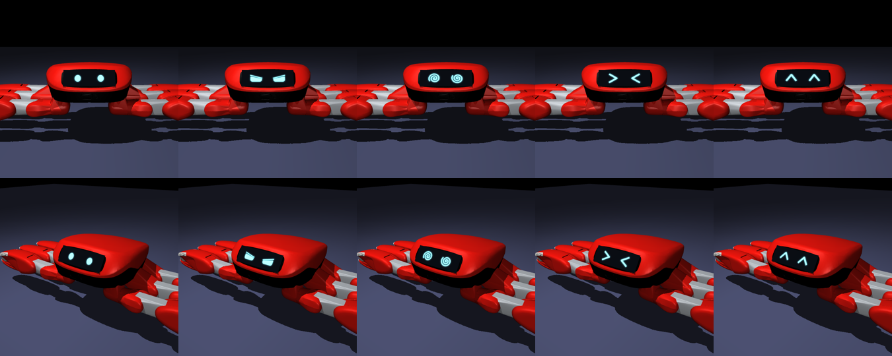

# Faces on the display (rendering only)

The crab's front panel is a display module (`display_module_link`, 10.7 × 3.9 cm). For the videos it
shows a face, drawn **in the simulator** on a thin textured screen fixed to that panel, so the face
turns, tilts and foreshortens with the body exactly as the panel does. The physics is untouched: the
screen is a visual geom (no contact, no mass) that exists only in the render model.

Left to right: neutral, serious, spiral, `> <`, `^ ^`.

## Use

Set `FACE` when rendering (`tools/probes/render_sim.py`, or any probe's `--render`):

| `FACE` | what the display shows |
|---|---|
| unset or `0` | nothing: the plain black panel, as before |
| `auto` | serious while practising, spiral eyes while the body spins, `> <` while it falls |
| `neutral`, `serious`, `spiral`, `cross`, `happy` | that one expression for the whole take |

- `FACE_BASE=neutral` makes `auto` rest on round eyes instead of serious ones (before any lesson).
- `FACE_HAPPY_AFTER=t` switches to `^ ^` from `t` seconds of simulation on.
- `FACE_DEBUG=face.csv` writes the tilt, yaw, smoothed yaw rate and expression of every frame.
- `RENDER_SIZE=270x480` renders small, for a quick look at timing.
- `JUMPER_REPO` points every probe at the jumper checkout (default `D:\IslandMaster\jumper`).

The render log ends with the expression timeline, in simulation time (video time = simulation time ×
the slow-motion factor), and the fastest steady turn of the take.

## The `auto` rules (`tools/probes/face_display.py`)

- **`> <` (falling)**: the body tilts more than 50° from upright, or a fall resets it (the base jumps
  more than 8 cm sideways between two frames). It shows at once and stays 0.6 s of simulation (1.8 s of
  video at a third of real speed), until the body is back within 35°.
- **spiral (spinning)**: the yaw rate, filtered with its sign over 0.5 s so that the twitch of each bounce
  cancels out, is above 0.8 rad/s (180° in 4 s); off below 0.5 rad/s. Only while upright (tilt < 30°),
  so a tumble is not a spin.
- otherwise the base expression; any change other than a fall waits 0.35 s, so the face does not flicker.

Checked on 10/10 (software rendering, this repository's probes): the scripted gymnast, seed 3, showed
`> <` at each of its falls (3.49, 4.36, 5.46, 6.59 s ...) and no spiral (fastest steady turn 0.57 rad/s);
the bounce dance (amplitude 4 cm, 3 Hz) showed spiral eyes while it turned at about 3 rad/s and the
serious face once it stopped.

## Reproducing a take

Takes made with `--seed` (probe_gymnast_v5) replay bit for bit on the machine they were made on. Older
takes had no seed, so a re-render with a face is a new take with the same settings: scout it again for
the moment the lesson shows (a fall, a spin, a clean bounce). The same seed on another machine is not
guaranteed to give the same take (seed 3 on Linux: 9 falls and 32.5 cm, against 5 falls and 40.7 cm on
the reception PC).
