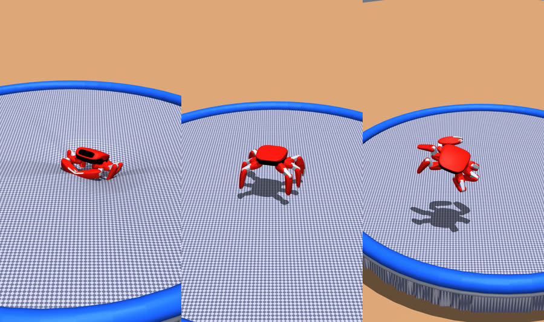

# 2026-10-10: a round trampoline, and 40.7 cm

Island Master's notes from the reception PC, for the coach's video and for whoever picks this up next.



## What changed today

**The scripted gymnast reached 40.7 cm** (the shipped `jumper.jump` policy reaches 14 cm on rigid ground).
Same controller as last night, `tools/probes/probe_gymnast_v5.py`, no policy and no training: all six
legs flex and push together from just before the bottom of the bed, the front arms thrust as it pushes,
the legs swing from the hip with the knee straight to right the body in the air, and all hip-yaw joints
swing together against any spin. It falls 5 times in 12 s. The coach's target, 30 cm five times in a
row, is **not** reached; the higher it jumps, the more it falls.

**Takes are now reproducible.** `--seed N` sets the environment's seed; on the native backend a take
replays bit for bit, so takes can be scouted headless (about a minute each) and only the good ones
rendered. With `--legacy-no-reset` (keep pushing through a fall's reset) and `--bed-friction 3.6`, 12 s:

| seed | apexes over 30 cm | highest | falls | character |
|---|---|---|---|---|
| 1 | 0 | 18 cm | 13 | a fall every 0.6 s |
| 2 | 1 | 31 cm | 4 | |
| **3** | **3** | **40.7 cm** | 5 | 34, 33, 41 cm late in the take |
| 4 | 0 | 28 cm | 4 | steady 25 cm |
| 5 | 0 | 18 cm | 16 | falls, again and again |

**The bed is drawn as a trampoline** (`tools/probes/render_sim.py`; visual only, the physics is still
the scene's flat compliant ground):

- the net is a height field with a fine two-tone weave, under the robot;
- the robot presses it **as one hexagonal plate**: inside the hull of the six feet the bed follows a
  plane fitted through the loaded feet's sink (level landing, level dish; tilted, tilted), drawn at the
  measured depth so the feet sit on the net;
- outside, the bed returns like a membrane under tension: the radial solution of Laplace's equation,
  `w(r) = w_a ln(R/r) / ln(R/a)`, a 25 cm return near the feet (the coach's chosen stiffness);
- with `ROUND_R` set, the net is a **round trampoline** fixed in the world, with a padded rim, frame
  and legs over a gym floor, and **the whole bed sags to the frame** along the same solution: one third
  of the depth is taken by the 25 cm return, two thirds by the long sag, and it is exactly zero at the
  frame (`ROUND_SAG=0.67`).

The circle has to contain the robot's path, since the physics bed is endless: seed 3 wanders over
x −0.31..+0.35 m, y −1.12..+0.28 m (a fall resets it to the middle), so the centre is (0.02, −0.42)
and the radius 1.2 m. `probe_gymnast_v5.py` logs `base_x` and `base_y` for this.

## The final clip

```powershell
cd D:\IslandMaster\jumper            # your jumper checkout, with this overlay installed
$env:DISH_MODE="hex"; $env:DISH_FALLOFF="0.25"; $env:DISH_GAIN="1.0"; $env:DISH_LIFT="0"
$env:ROUND_R="1.2"; $env:ROUND_CX="0.02"; $env:ROUND_CY="-0.42"; $env:ROUND_HEIGHT="0.25"; $env:ROUND_SAG="0.67"
python -I <overlay>\tools\probes\probe_gymnast_v5.py --seed 3 --amp 5.0 --arms 3.0 --vz-up -0.8 --flex 2.5 `
    --nose-wave flight --legacy-no-reset --slow 3 --elev -30 --dist 2.4 `
    --render out\clip.mp4 --out out\clip.csv -- `
    --task jumper.posture --agent zero --scene trampoline --bed-friction 3.6 `
    --backend native --device cpu --headless --steps 2400 --speed 0
```

12 s of simulation, drawn at a third of real speed (36 s of video, the coach's preference: the motion
and the direction of its momentum are easier to read), portrait 1080 × 1920, with a mask track of the
robot beside it. About 4 minutes on the reception PC. `RENDER_DISH=0` draws the plain scene floor
instead, for the older clips.

## What worked and what did not

- worked: pushing a little before the bottom of the bed (the PD lags), a deeper crouch, thrusting the
  front arms while pushing (and bringing them back in the air), swinging the legs from the hip with the
  knee straight in the air (the body turns against the limbs: measured, not guessed), raising both claws
  when the nose drops (higher, not safer), swinging all hip-yaw joints together against a spin
- did not: more bed friction (2x and 3x jump lower), arm timing alone, left/right leg sync against the
  spin, the twist command against the spin
- the wall at 30 cm x 5 is leg stiffness (kp 20: the push is lost in the legs' give) and the landing.
  Next: a landing that meets the bed with all six feet at once, the push started from fall speed and
  height rather than a threshold, and stage 1's training

## Pitfalls met today

- two `mujoco.Renderer`s have two GL contexts; `mjr_uploadHField` goes to whichever is current, so call
  `renderer._gl_context.make_current()` first (without it the dish went to the mask and the picture
  stayed flat)
- the robot's bodies are named `robot/...` in the scene model: match the foot names by suffix
- a height field needs 2 to 2.5 cm cells to show an 8 cm dish; a near-white net washes out under the
  scene's lights, so the weave is mid-grey
